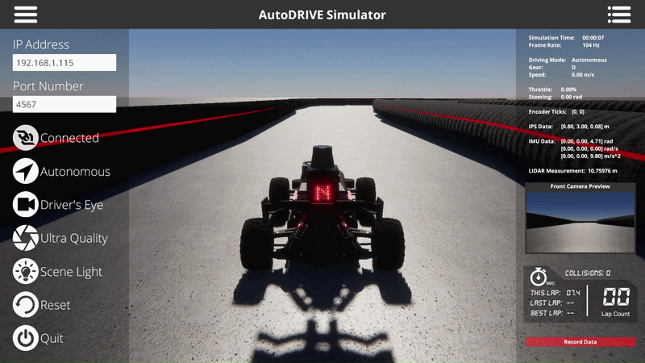

# Reactive Autonomy

**Authors:** [Chinmay Samak](https://www.linkedin.com/in/samakchinmay) and [Tanmay Samak](https://www.linkedin.com/in/samaktanmay)

The `reactive_autonomy` ROS 2 package contains reference implementations of multiple reactive autonomy algorithms (perception-enhanced vehicle control), which are relevant to autonomous racing application:

- **Emergency braking** algorithm uses LIDAR measurements to detect imminent frontal collisions and trigger emergency braking when necessary.
- **Wall following** algorithm uses LIDAR measurements to maintain a safe distance from track boundaries and navigate the racetrack without collisions.

> [!NOTE]
> - The ROS 2 nodes subscribe to `/scan` (`sensor_msgs/msg/LaserScan`) and publish to `/drive` (`ackermann_msgs/msg/AckermannDriveStamped`).
> - `/scan` contains an array of 360° range measurements spanning -180° to 180° at 0.25° resolution, represented as a 1440-bin array of float32 distances in meters. The `ranges` index 0 points straight behind the vehicle, and the subsequent elements progress counter-clockwise. Only the 270 deg window (|angle| <= 135°) carries returns; no-return = `inf`. The rear sector (between 135° and 225°) is blind; returns `inf`.
> - `/drive` expects `speed` and `steering_angle` commands for the vehicle to be normalized `[-1.0, 1.0]`. The actuation limits of the vehicle for `speed` and `steering_angle` are ±6 m/s (safety cap) and ±0.5236 rad (30°). For `speed`, positive command corresponds to forward vehicle motion, while negative command corresponds to reverse vehicle motion. For `steering_angle`, positive command corresponds to left-hand turn, while negative command corresponds to right-hand turn.

## Package description

```text
reactive_autonomy/
├── config/
│   ├── emergency_braking.yaml
│   └── wall_following.yaml
├── launch/
│   ├── emergency_braking.launch.py
│   └── wall_following.launch.py
├── reactive_autonomy/
│   ├── __init__.py
│   ├── emergency_braking.py
│   └── wall_following.py
├── resource/
│   └── reactive_autonomy
├── test/
│   ├── test_copyright.py
│   ├── test_flake8.py
│   └── test_pep257.py
├── package.xml
├── setup.cfg
└── setup.py
```

- `config/emergency_braking.yaml` — default parameters for the `emergency_braking` node when started by its launch file.
- `config/wall_following.yaml` — default parameters for the `wall_following` node when started by its launch file.
- `launch/emergency_braking.launch.py` — starts the `emergency_braking` executable and loads its YAML configuration.
- `launch/wall_following.launch.py` — starts the `wall_following` executable and loads its YAML configuration.
- `reactive_autonomy/__init__.py` — marks the Python module directory as the `reactive_autonomy` package.
- `reactive_autonomy/emergency_braking.py` — implements the `emergency_braking` algorithm as a ROS 2 node.
- `reactive_autonomy/wall_following.py` — implements the `wall_following` algorithm as a ROS 2 node.
- `resource/reactive_autonomy` — ament resource marker used to register the package in the ROS 2 package index.
- `test/test_copyright.py` — checks package files for required copyright notices.
- `test/test_flake8.py` — checks Python code style with Flake8.
- `test/test_pep257.py` — checks Python docstring conventions with PEP 257.
- `package.xml` — declares package metadata, maintainers, license, and dependencies.
- `setup.cfg` — configures where ROS 2 installs the Python executables.
- `setup.py` — defines the Python package, installed data files, metadata, and console entry points.

> [!TIP]
> - `reactive_autonomy` is an `ament_python` package with multiple console executables: `emergency_braking` and `wall_following`. Run only one node at a time to avoid a race condition, since they all publish to `/drive` topic.
> - The package was created with:
>   ```bash
>   ros2 pkg create --build-type ament_python reactive_autonomy --dependencies rclpy std_msgs geometry_msgs sensor_msgs nav_msgs ackermann_msgs
>   ```

## Setup and usage

### Simulator (digital twin)

1. From this lab directory, create a workspace and copy the package into its `src` directory:
    ```bash
    mkdir -p aueX930_ws/src
    cp -a reactive_autonomy aueX930_ws/src/
    ```
    Update any algorithm parameters within the respective `yaml` file in the `config` directory.

2. Run the [`autodrive_neoracer_api`](https://hub.docker.com/r/autodriveecosystem/autodrive_neoracer_api) container with the workspace mounted:
    ```bash
    docker run --name autodrive_neoracer_api --rm -it --network=host --ipc=host -v /tmp/.X11-unix:/tmp/.X11-unix:rw -v "$PWD/aueX930_ws":/root/aueX930_ws --env DISPLAY --privileged --gpus all autodriveecosystem/autodrive_neoracer_api:2026-fall-practice
    ```

3. In the container, build and source the workspace:
    ```bash
    cd ~/aueX930_ws
    colcon build --symlink-install --packages-select reactive_autonomy
    source install/setup.bash
    ```

4. Run the [`autodrive_neoracer_sim`](https://hub.docker.com/r/autodriveecosystem/autodrive_neoracer_sim) container in a separate host terminal:
    ```bash
    docker run --name autodrive_neoracer_sim --rm -it --network=host --ipc=host -v /tmp/.X11-unix:/tmp/.X11-unix:rw --env DISPLAY --privileged --gpus all autodriveecosystem/autodrive_neoracer_sim:2026-fall-practice
    ```
    Alternatively, you can choose to use the standalone executable of the AutoDRIVE Simulator for [Linux](https://github.com/AutoDRIVE-Ecosystem/Clemson-University-AuE-X930-Tech-Stack/releases/download/2026-fall/autodrive_simulator_practice_linux.zip) | [Windows](https://github.com/AutoDRIVE-Ecosystem/Clemson-University-AuE-X930-Tech-Stack/releases/download/2026-fall/autodrive_simulator_practice_windows.zip) | [macOS](https://github.com/AutoDRIVE-Ecosystem/Clemson-University-AuE-X930-Tech-Stack/releases/download/2026-fall/autodrive_simulator_practice_macos.zip) depending on your requirement.

6. Teleoperate and bring the NeoRacer digital twin to a desired initial pose. Use the `Driving Mode Button` in the ` Menu Panel` on the left-hand side to toggle the driving mode of the vehicle between `Manual` and `Autonomous` (default is `Autonomous`). The selected driving mode is displayed beside this button. The vehicle will listen to the `/drive` topic while in `Autonomous` mode.

7. Launch the reactive autonomy algorithm:
    - Emergency Braking:
      ```bash
      ros2 launch reactive_autonomy emergency_braking.launch.py
      ```
    - Wall Following:
      ```bash
      ros2 launch reactive_autonomy wall_following.launch.py
      ```
    Stop the node with `Ctrl`+`C` before starting another node that publishes to `/drive` topic to avoid a race condition.

    While the node is running, you can update certain algorithm parameters using ROS 2 CLI:
    ```bash
    ros2 param set <node_name> <param_name> <param_value>
    ```

### Testbed (physical twin)

1. From this lab directory, create a workspace and copy the package into its `src` directory:
    ```bash
    mkdir -p aueX930_ws/src
    cp -a reactive_autonomy aueX930_ws/src/
    ```
    Update any algorithm parameters within the respective `yaml` file in the `config` directory.

2. Build and source the workspace:
    ```bash
    cd ~/aueX930_ws
    colcon build --symlink-install --packages-select reactive_autonomy
    source install/setup.bash
    ```

3. Place the NeoRacer physical twin on the ground and make sure the area is secure for any experimentation. Flip the toggle switch (second from left) on the RC transmitter to the bottom position for the vehicle to listen to the `/drive` topic (i.e., operate in `Autonomous` mode). The toggle switch can be flipped to the top position during an autonomous run for manual override to avoid any collisions or accidents.

4. Launch the reactive autonomy algorithm:
    - Emergency Braking:
      ```bash
      ros2 launch reactive_autonomy emergency_braking.launch.py
      ```
    - Wall Following:
      ```bash
      ros2 launch reactive_autonomy wall_following.launch.py
      ```
    
    Stop the node with `Ctrl`+`C` before starting another node that publishes to `/drive` topic to avoid a race condition.
    
    While the node is running, you can update certain algorithm parameters using ROS 2 CLI:
    ```bash
    ros2 param set <node_name> <param_name> <param_value>
    ```

## Expected outcomes

### Emergency braking



### Wall following


